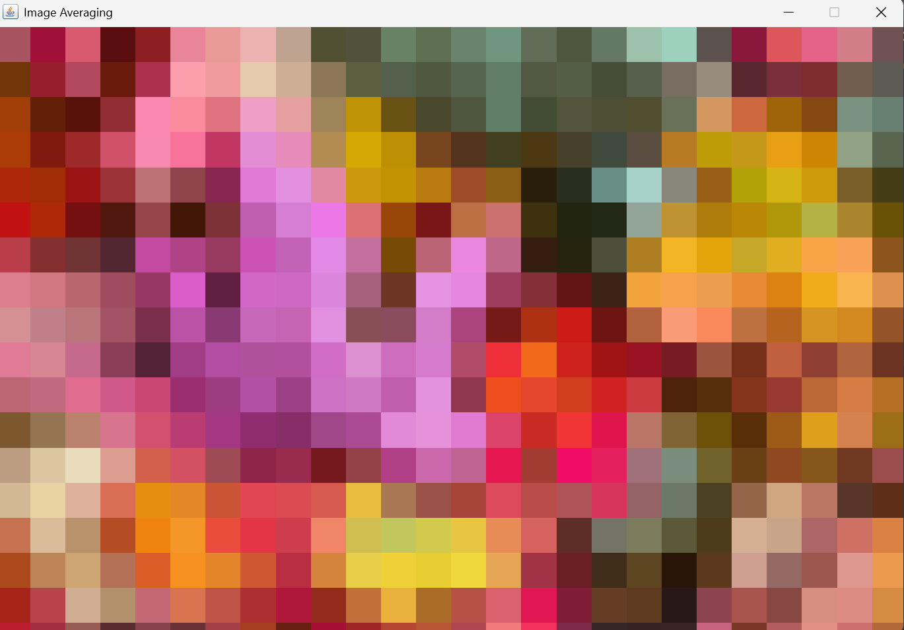

# Single-Threaded and Multi-Threaded Image Processing

## Assignment intro
In this project, I implemented an image averaging program using Java. The main goal was to divide an image into smaller squares and replace all pixels inside each square with the average RGB color of that square. This creates a pixelated effect.
I implemented two processing modes: single-threaded and multi-threaded. I also added a visualization that allows the user to see the image changing during processing instead of displaying only the final result.

## Implementation

### 1. Input Handling and Image Loading

I started by implementing the command-line argument handling in `Main.java`. The program requires three arguments: the input image filename, the square size, and the processing mode.
First, I added a check to make sure that exactly three arguments are provided. Then, I implemented validation for the square size to ensure that it is a valid positive integer.

Later, I added mode validation to accept only `S` or `M`, representing single-threaded and multi-threaded processing. If the user provides an invalid argument, the program displays an error message and stops. After handling the arguments, I implemented image loading using Java's `ImageIO` class. I also added a check to make sure that the input file can be successfully read as an image.

### 2. Implementing Square Averaging

I created the `SquareAveraging.java` class to handle the processing of individual squares. I first implemented the `averageColor()` method. It goes through every pixel inside a selected square and separately calculates the total red, green, and blue values. Then, I divide each total by the number of pixels to obtain the average RGB color.

After thay, I implemented the `fillSquare()` method, which replaces every pixel inside the square with the calculated average color. I combined these two operations in the `averageSquare()` method so that a square can be averaged and filled with a single method call.

I also considered images whose dimensions are not divisible by the selected square size. For example, if the image width is 1050 pixels and the square size is 100, the last square in each row will be only 50 pixels wide. To handle these cases, I used `Math.min()` when calculating the ending X and Y coordinates. This prevents the program from accessing pixels outside the image boundaries and ensures that all pixels, including those at the right and bottom edges, are processed.

### 3. Implementing Single-Threaded Processing

After implementing the processing of individual squares, I moved to the `ImageAveraging.java` class. I first created the `averageRows()` method. It uses two loops to go through the image: the outer loop moves vertically, while the inner loop moves horizontally. Both loops increase by the selected square size, allowing the image to be processed square by square.

Then, I implemented the `singleThreaded()` method, which calls `averageRows()` for the entire image. In this mode, one thread processes all squares sequentially.

### 4. Adding Multi-Threaded Processing

After completing the single-threaded implementation, I added a multi-threaded method to process different parts of the image simultaneously. I used `Runtime.getRuntime().availableProcessors()` to determine the number of available CPU cores. The number of threads is based on this value, but it cannot be greater than the number of square rows in the image.

Instead of assigning individual squares to different threads, I decided to divide the image into groups of square rows. Each thread receives a separate section of the image. First, I calculate the total number of square rows using the image height and the selected square size. Then, I calculate how many rows each thread should process. If the rows cannot be divided equally, I distribute the remaining rows among the first few threads. 

For each thread, I calculate its starting and ending Y coordinates. Then, I create a new thread that calls the same `averageRows()` method used in single-threaded processing, but with its own assigned range.

I used `start()` to start each thread. Since the threads work on separate groups of rows, they do not overwrite each other's pixels. After starting all threads, I use `join()` to wait until every thread finishes its work.

### 5. Adding Visualization

For this, I created the `Visualization.java` class using Java Swing. I added a window that displays the original image before processing starts.

Initially, I added the visualization to display the image, but I later updated it to show the changes as the processing happens. I added the `repaintSquare()` method to repaint only the area corresponding to the square that has just been processed. I then updated `ImageAveraging.java` to call this method after processing each square. This allows the user to see the image changing gradually.

I also added a short delay using `Thread.sleep(100)` after processing each square. Without this delay, the processing could happen too quickly for the user to clearly observe the changes.

### 6. Updating Image Scaling and Window Size

I also considered the case where the input image is larger than the available screen area.

Initially, I added functionality to resize large images for display. Later, I updated the `Visualization` class to calculate a scaling factor based on the available screen width and height.

I used `Math.min()` to make sure that the image fits within the available display area while keeping its original proportions. The image is only scaled down when necessary and is never stretched or enlarged. I also updated the window dimensions and drawing method to make sure that the image is displayed without distortion.

This resizing only affects visualization. All averaging calculations are still performed using the original image, so the original dimensions are preserved during processing.

### 7. Saving the Processed Image

Finally, I added functionality to save the processed image as `result.jpg` using `ImageIO.write()`.

I also updated the saving part to check whether the image was successfully written before displaying the success message. The program waits for the processing to finish before saving the result. In multi-threaded mode, this is ensured using `join()`, so the image is not saved while the threads are still working.

## How to Run the Program

The program takes three command-line arguments:

- `filename`: Path to the input JPG image.
- `square_size`: Size of each square in pixels.
- `mode`: `S` for single-threaded or `M` for multi-threaded processing.

First, compile the Java files:

```bash
javac -d out Main.java Visualization.java ImageAveraging.java SquareAveraging.java
```

To run in single-threaded mode:

```bash
java -cp out Main image.jpg 20 S
```

To run in multi-threaded mode:

```bash
java -cp out Main image.jpg 20 M
```

After processing is complete, the resulting image is saved as `result.jpg` in the project directory.


## Example Results

Here I will include screenshots of the original image and the results produced by the program.

### Original Image


### Single-Threaded Result



### Multi-Threaded Result


